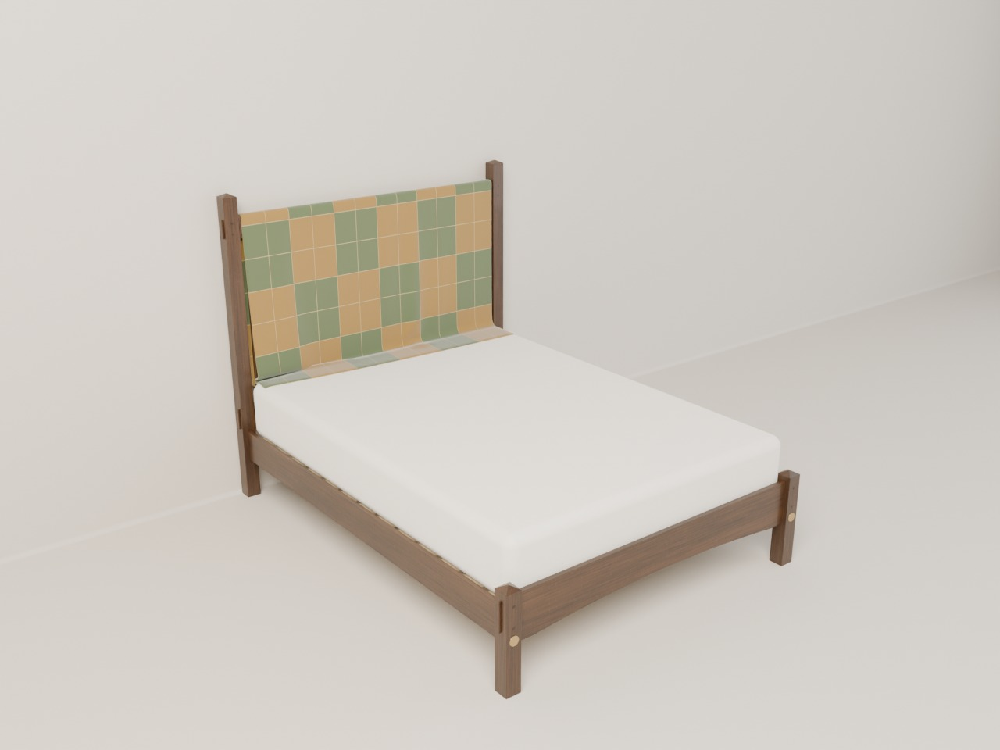

<!-- Generated by tools/build_deliverables.py. -->
# Designs

Everything for each design, ready to share: pictures, drawings, a build guide, and one printable PDF. Open a design for its page.

### [Queen bed frame](bed-frame/)

An Arts & Crafts queen bed frame in quartersawn white oak, made to wear a washable quilt over its headboard: square posts with pyramid caps, through-tenons pegged through the posts, wide flat slats to lean against, and a low arched foot rail with short capped legs.

[Build packet (PDF)](bed-frame/bed-frame-build-packet.pdf)
