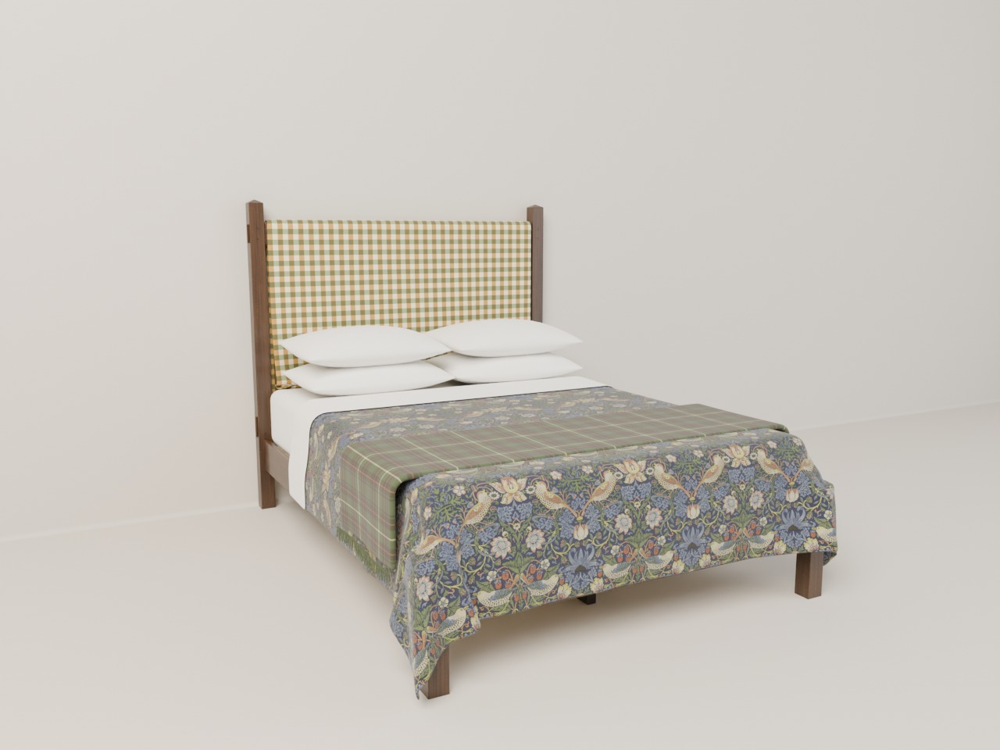
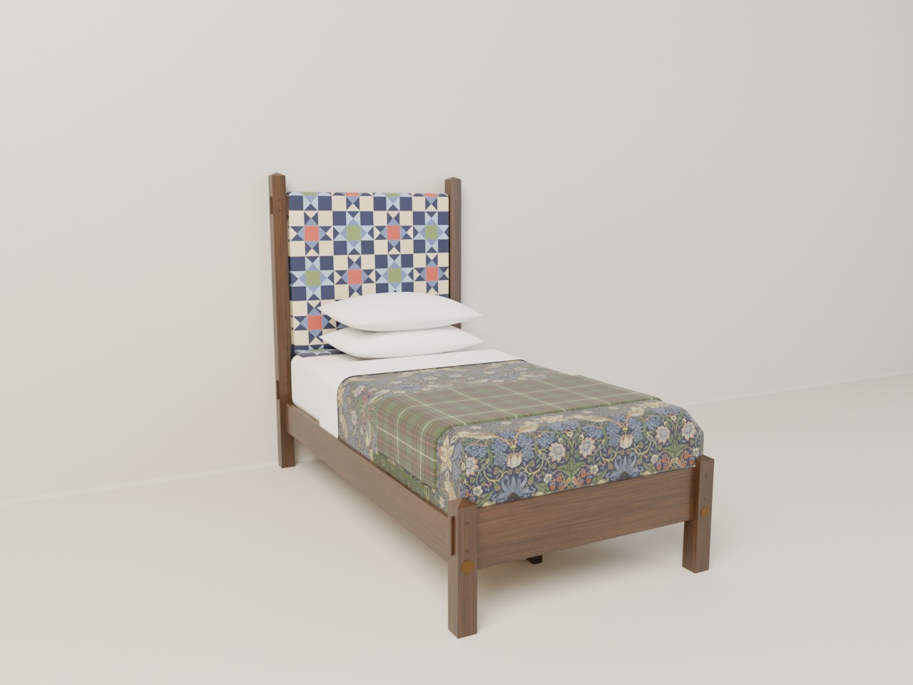
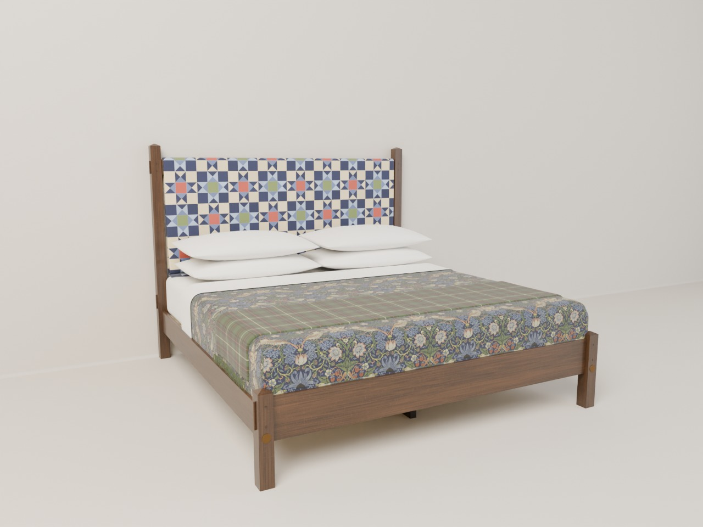
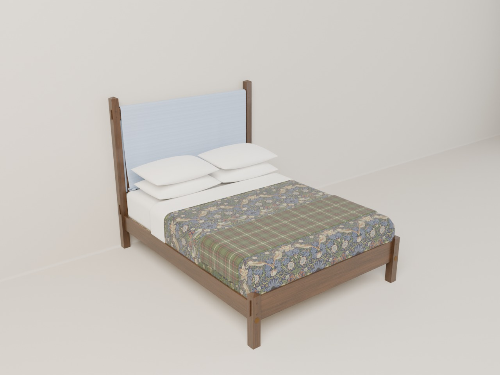
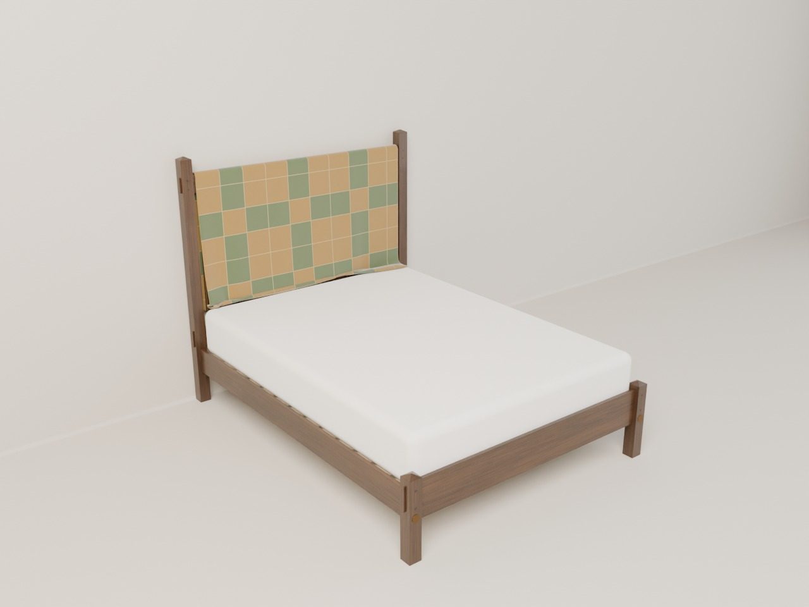
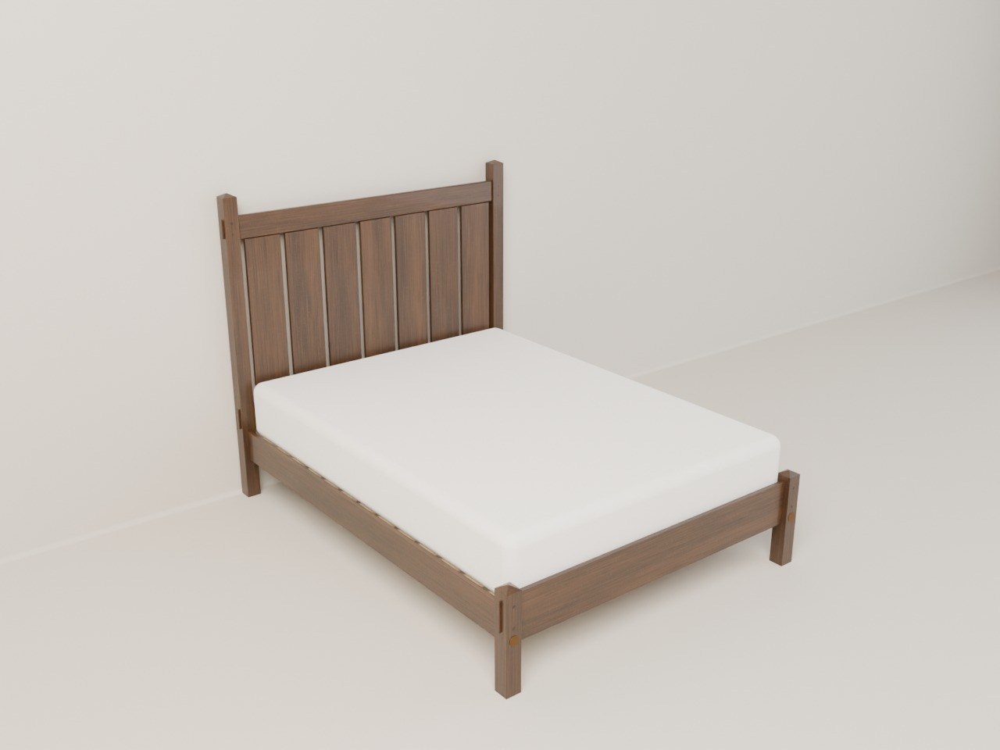
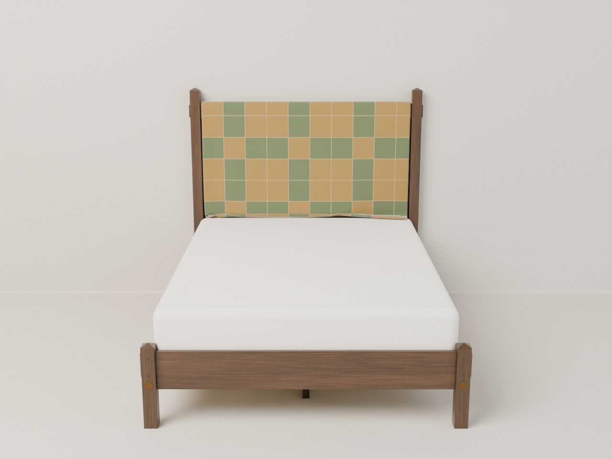
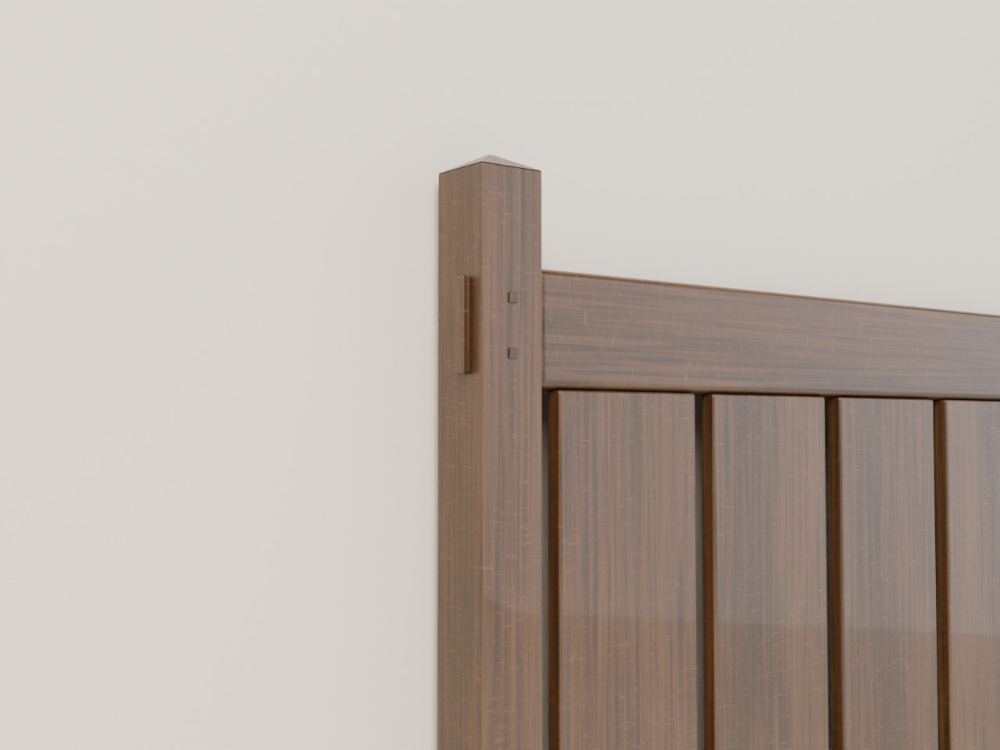
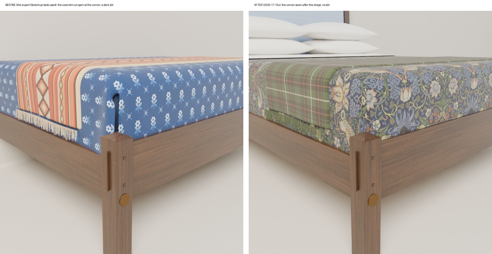
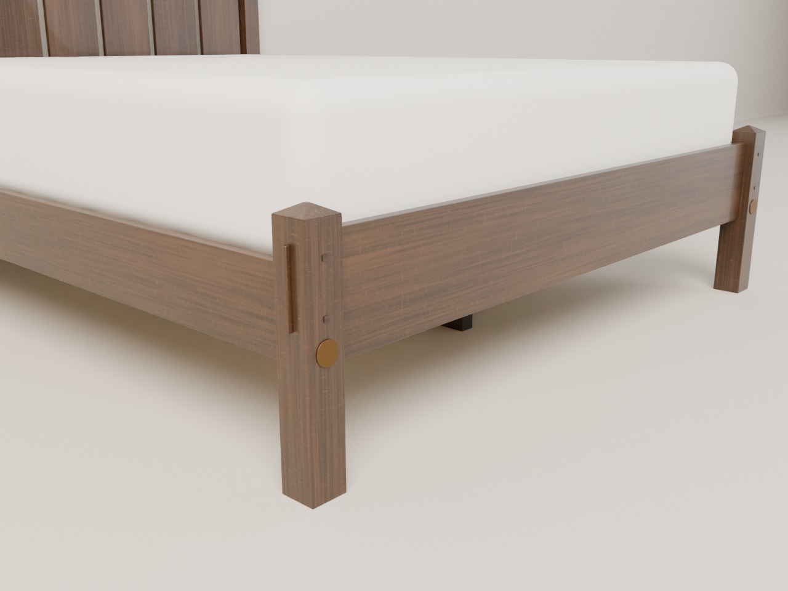

<!-- Generated by tools/build_deliverables.py from designs/bed-frame/: edit those, not this. -->

# Queen bed frame

An Arts & Crafts queen bed frame in quartersawn white oak, made to wear a washable quilt over its headboard: square posts with pyramid caps, through-tenons pegged through the posts, wide flat slats to lean against, and a low foot rail with short capped legs.

**[Download the build packet (PDF)](bed-frame-build-packet.pdf)**: the pictures, the drawings and the build guide in one printable file.

## Drawings

- **Overall drawing and cut list:** [view](bed-frame-drawing.svg) (sharp at any zoom), [PDF to print](bed-frame-drawing.pdf)
- **Joinery:** [view](bed-frame-joinery.svg) (sharp at any zoom), [PDF to print](bed-frame-joinery.pdf)
- **Footprint, for a room's plan:** [view](bed-frame-footprint.svg) (sharp at any zoom), [PDF to print](bed-frame-footprint.pdf)
- **The twin, overall drawing and cut list:** [view](bed-frame-twin-drawing.svg) (sharp at any zoom), [PDF to print](bed-frame-twin-drawing.pdf)
- **The twin's footprint:** [view](bed-frame-twin-footprint.svg) (sharp at any zoom), [PDF to print](bed-frame-twin-footprint.pdf)
- **The king, overall drawing and cut list:** [view](bed-frame-king-drawing.svg) (sharp at any zoom), [PDF to print](bed-frame-king-drawing.pdf)
- **The king's footprint:** [view](bed-frame-king-footprint.svg) (sharp at any zoom), [PDF to print](bed-frame-king-footprint.pdf)

## How to build it

[The build guide](BUILD.md): materials with estimated prices, tools, and the steps in order.

## 3D model

- **How to use the 3D model in another room's render (sizes, placing, SketchUp, rights):** [README.md](model/README.md)
- **The model's version and every file's sha256:** [VERSION](model/VERSION)
- **What changed in each version:** [CHANGELOG.md](model/CHANGELOG.md)
- **Ready-to-paste records for Sketchup-tools' library:** [library.yaml](model/library.yaml)
- **The bed made up (Blender 4.5):** [bed-frame-made-up.blend](model/bed-frame-made-up.blend)
- **The bare frame and mattress (Blender 4.5):** [bed-frame-bare.blend](model/bed-frame-bare.blend)
- **The frame with a quilt over the headboard (Blender 4.5):** [bed-frame-quilt.blend](model/bed-frame-quilt.blend)
- **The bed made up (glTF):** [bed-frame-made-up.glb](model/bed-frame-made-up.glb)
- **The bare frame and mattress (glTF):** [bed-frame-bare.glb](model/bed-frame-bare.glb)
- **The frame with the quilt (glTF):** [bed-frame-quilt.glb](model/bed-frame-quilt.glb)
- **The twin, made up (Blender 4.5):** [bed-frame-twin-made-up.blend](model/bed-frame-twin-made-up.blend)
- **The twin, bare (Blender 4.5):** [bed-frame-twin-bare.blend](model/bed-frame-twin-bare.blend)
- **The king, made up (Blender 4.5):** [bed-frame-king-made-up.blend](model/bed-frame-king-made-up.blend)
- **The king, bare (Blender 4.5):** [bed-frame-king-bare.blend](model/bed-frame-king-bare.blend)
- **The twin, made up (glTF):** [bed-frame-twin-made-up.glb](model/bed-frame-twin-made-up.glb)
- **The twin, bare (glTF):** [bed-frame-twin-bare.glb](model/bed-frame-twin-bare.glb)
- **The king, made up (glTF):** [bed-frame-king-made-up.glb](model/bed-frame-king-made-up.glb)
- **The king, bare (glTF):** [bed-frame-king-bare.glb](model/bed-frame-king-bare.glb)
- **For SketchUp, in inches (COLLADA .dae files and their images):** [sketchup/](model/sketchup/)

## Pictures

*Made up, William Morris's Strawberry Thief on the coverlet tucked into the frame, a white top sheet turned down, a wool plaid blanket, white pillows two by two, and a star quilt in the coverlet's colors over the headboard*

*The twin, made up the same way, one column of pillows (a pair for the NW bedroom)*

*The king, made up the same way, with king pillows (for the SE bedroom)*

*The same, from above the foot*

*With a quilt draped over the headboard*

*The bare frame*

*From the foot*

*A head post's pyramid cap, and the top rail's through-tenon and pegs*

*The coverlet's foot corner: before, cut open with a slit; after, its flaps sewn together after the drape*

*The foot's corner, with its pegged through-tenon and brass bolt cover*

## The design

64 7/8" wide over the tenons, 85 1/8" long, 60 1/8" to the post tops.

- **Headboard posts:** two 2 3/4" square posts with shallow pyramid caps.
  They stand 3 1/2" above the top rail, so they show above the folded quilt.
- **The headboard's rails** go right through the posts, with their tenons
  standing 3/8" proud on the outside faces. Each tenon is held by two square
  oak pegs through the posts' front faces. This through-tenon joinery is the
  most recognizable mark of Stickley's furniture.
- **Seven wide flat slats** sit flush with the rails' faces, so you lean
  against a flat panel.
- **The top rail** is at 56", 32" above the mattress top, so someone tall
  can sit up against it with pillows (raised from 49", 2026-11-10). It has
  well-rounded 3/8" edges.
- **Foot:** no tall posts. A straight foot rail keeps the mattress in
  place (an arched one showed the support under the bed, dropped
  2026-11-11). It's through-tenoned and pegged
  into two short legs. The legs have the same 2 3/4" section as the head
  posts and stand 1" above the rail with the same pyramid cap, as period
  beds' low posts did. Their tops are still 6" below the mattress top
  (decided 2026-11-10: hiding them under the rail would be a modern
  platform-bed look).
- **Side rails:** on one bed bolt and a stub tenon at each end, the way
  period beds were. The foot's bolts have aged-brass covers, the small
  round caps on the foot legs (darkened 2026-11-11 so they don't stand out).
- **Support:** 2x4 cleats inside the side rails, thirteen poplar slats, and
  a 2x4 center rail on three legs stained dark (they can be seen under
  the foot rail from low down).
- **Twin and king** (Sketchup-tools, 2026-11-14: a pair of twins for the
  NW bedroom, a king for the SE bedroom): the same bed at each size,
  `python3.11 designs/bed-frame/model.py --size twin` or `--size king`.
  The posts, rails and joinery are the queen's, and the headboard keeps
  the queen's slat width: four slats on the twin, nine on the king. The
  twin is 42 7/8" x 80 1/16" over the tenons, and the king
  80 7/8" x 85 1/16". Each has its own drawing and cut list
  ([twin](bed-frame-twin-drawing.svg), [king](bed-frame-king-drawing.svg)).
  BUILD.md's steps are the same for each.
- **Made up** (2026-11-15): Morris's Strawberry Thief on a coverlet tucked
  in between the mattress and the rails, its foot corners sewn; a white
  top sheet turned down 10"; a wool plaid blanket across the foot; white
  pillows two by two (one column on the twin, king pillows on the king);
  and a pieced Ohio Star quilt over the headboard, in the coverlet's
  navy, blues, sage, biscuit and strawberry red (client, 2026-11-15).
- **Finish:** fumed, a deep brown, as Stickley's workshops did it; or dyed
  to match (BUILD.md, step 15).

---
Updated November 15, 2026. Made with [Design-render](../../README.md); the model and its sources are in [designs/bed-frame](../../designs/bed-frame/).
