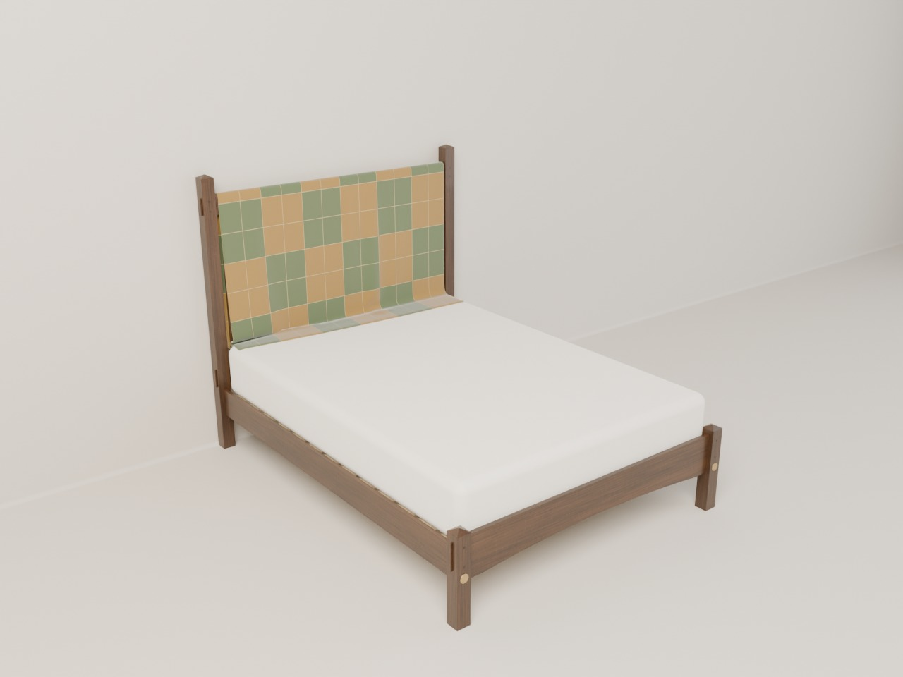
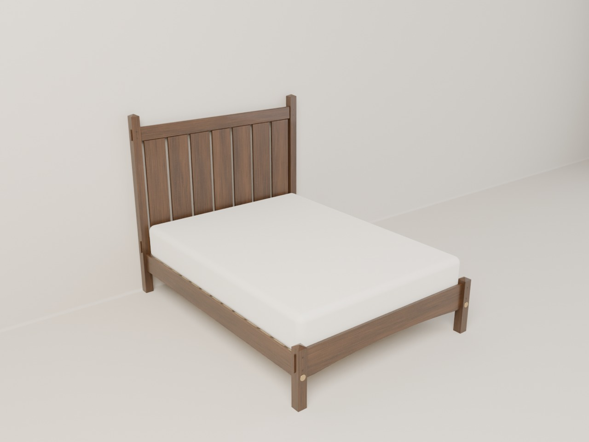
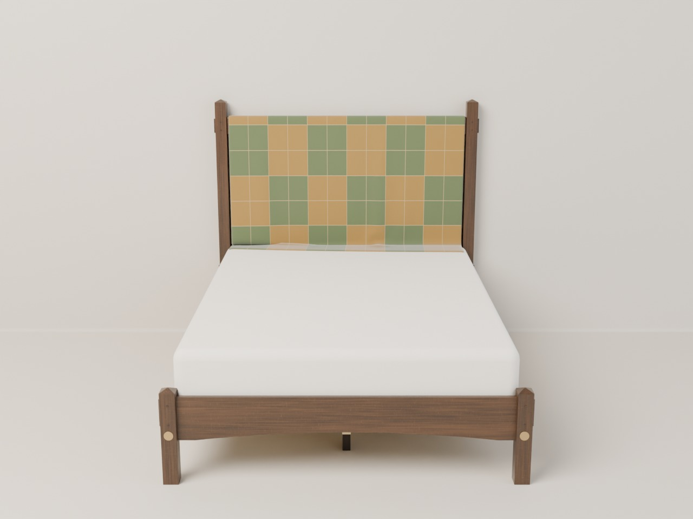
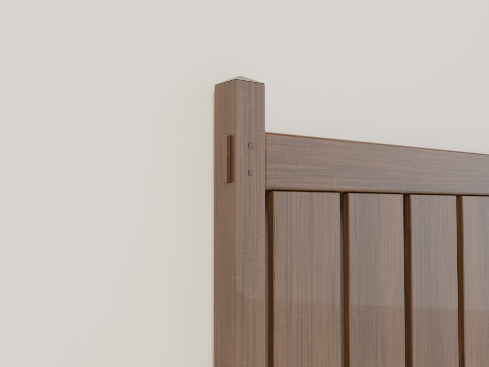
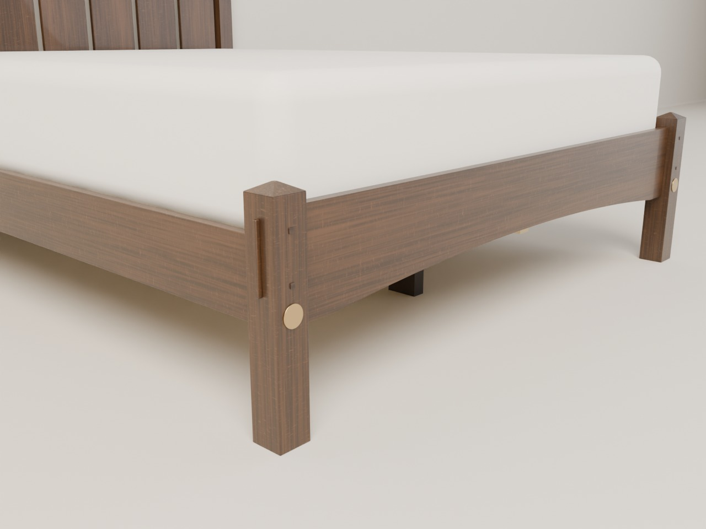

<!-- Generated by tools/build_deliverables.py from designs/bed-frame/: edit those, not this. -->

# Queen bed frame

An Arts & Crafts queen bed frame in quartersawn white oak, made to wear a washable quilt over its headboard: square posts with pyramid caps, through-tenons pegged through the posts, wide flat slats to lean against, and a low arched foot rail with short capped legs.

**[Download the build packet (PDF)](bed-frame-build-packet.pdf)**: the pictures, the drawings and the build guide in one printable file.

## Drawings

- **Overall drawing and cut list:** [view](bed-frame-drawing.svg) (sharp at any zoom), [PDF to print](bed-frame-drawing.pdf)
- **Joinery:** [view](bed-frame-joinery.svg) (sharp at any zoom), [PDF to print](bed-frame-joinery.pdf)

## How to build it

[The build guide](BUILD.md): materials with estimated prices, tools, and the steps in order.

## Pictures

*With a quilt draped over the headboard*

*The bare frame*

*From the foot*

*A head post's pyramid cap, and the top rail's through-tenon and pegs*

*The foot's corner, with its arched rail, pegged tenon and brass bolt cover*

## The design

64 7/8" wide over the tenons, 85 1/8" long, 60 1/8" to the post tops.

- **Headboard posts:** two 2 3/4" square posts with shallow pyramid caps.
  They stand 3 1/2" above the top rail, so they show above the folded quilt.
- **The headboard's rails** go right through the posts, with their tenons
  standing 3/8" proud on the outside faces. Each tenon is held by two square
  oak pegs through the posts' front faces. This through-tenon joinery is the
  most recognizable mark of Stickley's furniture.
- **Seven wide flat slats** sit flush with the rails' faces, so you lean
  against a flat panel.
- **The top rail** is at 56", 32" above the mattress top, so someone tall
  can sit up against it with pillows (raised from 49", 2026-11-10). It has
  well-rounded 3/8" edges.
- **Foot:** no tall posts. A foot rail with a gently arched bottom edge
  (1 1/2" rise) keeps the mattress in place. It's through-tenoned and pegged
  into two short legs. The legs have the same 2 3/4" section as the head
  posts and stand 1" above the rail with the same pyramid cap, as period
  beds' low posts did. Their tops are still 6" below the mattress top
  (decided 2026-11-10: hiding them under the rail would be a modern
  platform-bed look).
- **Side rails:** on one bed bolt and a stub tenon at each end, the way
  period beds were, with brass covers on the foot's bolts.
- **Support:** 2x4 cleats inside the side rails, thirteen poplar slats, and
  a 2x4 center rail on three legs stained dark (they show through the
  arch).
- **Finish:** fumed, a deep brown, as Stickley's workshops did it; or dyed
  to match (BUILD.md, step 15).

---
Updated November 11, 2026. Made with [Design-render](../../README.md); the model and its sources are in [designs/bed-frame](../../designs/bed-frame/).
